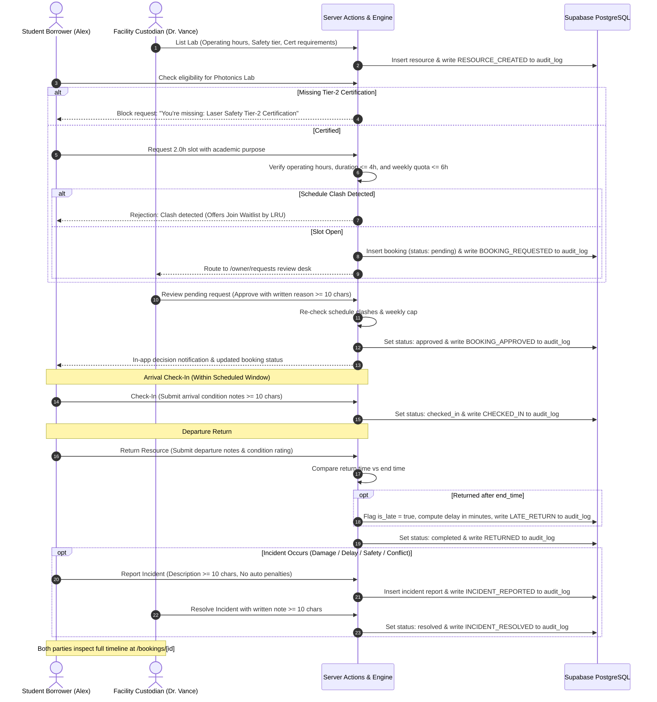

# CampusShare — Technical Project Report

**Project Title:** CampusShare — Trusted Collegiate Resource Sharing Platform  
**Repository:** [https://github.com/Sumaan0104/Hackathon.git](https://github.com/Sumaan0104/Hackathon.git)  
**Hackathon Track:** Full-Stack Web Development, Campus Innovation & Trust Systems  
**Authors & Tech Leads:** CampusShare Development Team  

---

## 1. Executive Summary & Problem Definition

### Why the Problem Matters
Across modern colleges and universities, millions of dollars worth of specialized equipment, laboratories, and creative spaces sit idle outside scheduled classes:
- **Equipment Underutilization:** Laser spectroscopy benches, full-frame cinema camera packages, makerspace multi-toolhead 3D printers, and anechoic test chambers often have daytime utilization rates as low as 20–30%.
- **Siloed Departmental Access:** Gear purchased by one department (e.g. Media Arts) is virtually invisible to students in adjacent disciplines (e.g. Environmental Science researchers needing camera kits for field documentary b-roll).
- **Hoarding & Resource Depletion:** When access is unmanaged, a handful of high-frequency researchers monopolize facilities, leaving freshmen and multidisciplinary students shut out.
- **Fear of Damage & Liability:** Faculty PIs hesitate to share sensitive equipment without verified safety certifications, arrival condition baselines, and transparent accountability.
- **Punitiveness Destroys Trust:** Typical enterprise reservation systems impose automated lockouts, fines, or bans when an experiment overruns or an accidental glitch occurs, deterring students from taking research risks.

### The Solution: CampusShare
CampusShare is an open yet trusted platform enabling university departments to share underused assets with students and cross-disciplinary researchers under strict collegiate trust governance:
- **Server-enforced eligibility:** Automatic verification of Environmental Health & Safety (EHS) certificates.
- **Equitable allocation:** A weekly 6.0-hour cap per user with real-time feedback on hours remaining.
- **Fair-access waitlists:** Queue positions prioritized by least recent use (LRU).
- **Custodian authority & transparency:** Every approval, rejection, or waitlist requires a written justification of at least 10 characters.
- **Arrival & departure verification:** Mandatory condition inspection notes with condition ratings and late return detection.
- **Collegiate safety model:** Universal incident reporting with an explicit "No Automated Penalties" guarantee.

---

## 2. Target Users & Personas

| Persona Role | Target User | Needs & Pain Points | CampusShare Capability |
| :--- | :--- | :--- | :--- |
| **Borrower (`user`)** | Students, capstone seniors, graduate researchers | Needs access to high-end labs; frustrates when slots are double-booked or monopolized. | Discovers campus-wide assets, verifies cert eligibility upfront, books within 6h cap, joins LRU waitlist. |
| **Custodian (`owner`)** | Lab managers, PIs, department heads | Worries about uncertified users damaging fragile equipment or returning gear late. | Retains decision authority with mandatory written reasons; reviews arrival/return notes; resolves reported incidents. |
| **Facilities Oversight (`manager`)** | Campus space managers, equipment depot staff | Needs bird's-eye visibility over turnover delays, cleanliness, and maintenance queues. | Monitors incident desk, reviews turnaround delays, overrides schedule conflicts. |
| **Campus Admin (`admin`)** | Academic deans, university provost office | Ensures departmental compliance, equitable student access, and verifiable audit trails. | Inspects immutable `audit_log`, reviews cross-department utilization rates, resets demo fixtures. |

---

## 3. Full End-to-End Workflow



---

## 4. Key Features Built During Hackathon

1. **Server-Gated Owner Review Portal (`/owner/requests`):**
   - Access restricted to `owner`, `manager`, and `admin` via server-side role check.
   - Summarizes requester department, certifications held vs required, 6.0h quota progress bar, and waitlist position.
   - Enforces a minimum 10-character written reason with live character counters.
   - Re-checks schedule conflicts and weekly cap on the server before approving.
2. **Window-Guarded Arrival Check-In:**
   - The "Check In" button is visible and active **strictly within the scheduled window** (`start_time <= now <= end_time`). Outside this window, it displays the exact schedule opening time.
   - Enforces physical condition inspection notes ($\ge 10$ characters) and inspection checklists.
3. **Condition Rating & Late Turnaround Tracking:**
   - Return modal captures condition rating (`Good`, `Minor Wear`, `Damaged`) and departure notes.
   - Server computes delay in minutes if returned late, flags `is_late = true`, and emits `LATE_RETURN` to the audit log.
4. **Universal Incident Reporting & Custodian Resolution:**
   - Universal reporting on any booking across categories: `damage`, `delay`, `safety`, and `conflict`.
   - Custodians can mark incidents resolved with a written justification ($\ge 10$ characters).
   - Strict "No Automated Penalties" guarantee preserved in UI and audit logs.
5. **Confidential Booking Audit Timeline (`/bookings/[id]`):**
   - Restricted strictly to the borrower and the facility custodian (returns 403 for unauthorized users).
   - Chronological visual timeline synthesizing all booking lifecycle events and audit log entries.
6. **In-App Notification Bell:**
   - Real-time decision alerts in the top navigation bar with unread counters and dropdown review notes.
7. **Cross-Device Supabase PostgreSQL Sync:**
   - Full live database persistence across `profiles`, `resources`, `bookings`, `incidents`, and `audit_log` with defensive fallback caching in `.data/shared_db.json`.

---

## 5. Technology Stack & Architecture

```
CampusShare Platform
├── Presentation Layer
│   ├── Next.js 16.4.3 (App Router with Turbopack)
│   ├── React 19 (Server Actions, React Hooks, use(params))
│   ├── Tailwind CSS v4 (Modern responsive utility system)
│   └── Lucide React (Crisp, standardized iconography)
├── Application & Enforcement Layer
│   ├── Node.js Server Actions (Role gates, window checks, clash detection)
│   ├── CampusShareStore (Authoritative rule engine & LRU priority queue)
│   └── Next.js Route Handlers & Server Components
└── Data & Persistence Layer
    ├── Supabase PostgreSQL (Remote cloud database with RLS policies)
    ├── Supabase PostgREST (High-performance direct table operations)
    ├── Supabase Auth (Cookie-based session verification)
    └── Local Disk Cache (.data/shared_db.json fallback engine)
```

---

## 6. AI Tools & Agentic Engineering (Google Antigravity & Gemini)

CampusShare was architected and built using **Google Antigravity** powered by **Gemini 2.5 Pro**:
- **Agentic Planning & Spec Adherence:** Translated high-level collegiate governance requirements from `SPEC.md` into structured implementation plans with mermaid diagrams and formal verification steps.
- **Strict Server-Side Hardening:** Designed authoritative server action validation routines ensuring that client-side controls cannot be bypassed via direct API calls.
- **Defensive Error Handling:** Authored PostgREST retry mechanisms and safe Next.js 16 route parameter unwrappers to eliminate hydration errors and schema mismatches.
- **Mathematical Fair-Access Algorithms:** Formulated and implemented the Least-Recently-Used (LRU) priority queue and weekly quota boundary calculations.

---

## 7. Privacy, Security & Fairness

1. **Privacy Protection:**
   - Student identities and stated research purposes are strictly confidential.
   - Public facility cards never expose student PII or active borrower identities.
   - Booking timelines and inspection notes are protected by a server 403 authorization barrier.
2. **Security Controls:**
   - Role checks are performed on the server inside server actions rather than trusting client state.
   - Zero secrets committed: `.env.local` is strictly excluded by `.gitignore`.
3. **Fairness Guarantees:**
   - 6.0-hour weekly quota prevents monopolization of high-demand labs.
   - LRU waitlists prevent rapid re-booking by repeat users, guaranteeing equitable access for new researchers.

---

## 8. Known Limitations & Future Scope

### Known Limitations
1. **Booking Cancellation:** While `BookingStatus` supports `'cancelled'`, a self-service cancellation button is not yet exposed in the UI.
2. **Notification Remote Schema:** In-app notifications are stored in the server store and local JSON cache rather than a dedicated Supabase `notifications` table.

### Future Scope
1. **IoT Smart-Lock Integration:** Connect check-in actions directly to campus NFC card readers or electronic door strikes so facilities physically unlock upon check-in.
2. **Supabase Realtime WebSockets:** Implement live push updates across judge devices using Supabase channels.
3. **QR Code Equipment Badges:** Equip physical benches and cameras with QR codes allowing students to scan and launch the check-in inspection modal on mobile.
