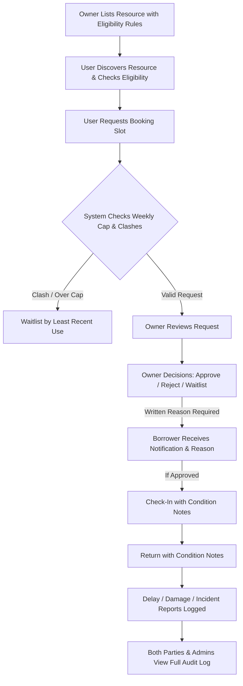

# CampusShare 🏫🔬

**CampusShare** is a trusted platform for sharing underused labs, high-end equipment, and specialized spaces across college campus departments with transparent, audit-logged governance.

Built for hackathon demonstration with **Next.js 16 (App Router)**, **TypeScript**, **Tailwind CSS**, and **Supabase (PostgreSQL + Auth + RLS)**.

---

## 🌟 Core Highlights & Architectural Rules

- **Strict Server Role Authorization**:
  - Roles: `user` (student/researcher), `owner` (lab PI/faculty), `manager` (facilities oversight), and `admin` (academic dean).
  - All role authorization checks happen strictly on the server.
- **Weekly Usage Cap**:
  - Enforces a weekly usage quota per user (default **6.0 hours/week**) to ensure equitable campus distribution.
  - Real-time impact indicators and quota warnings during reservation requests.
- **Clash Detection & Fair-Access Waitlist**:
  - Live schedule conflict detection prevents double booking.
  - Conflicting requests join the **Waitlist ordered by least recent use** — prioritizing researchers who haven't used the facility recently or ever.
- **Mandatory Written Justification**:
  - Owners retain final decision authority.
  - Every **Approve**, **Reject**, or **Waitlist** action requires a written reason that is permanently recorded in `audit_log` and presented to the borrower.
- **Condition Inspections**:
  - **Check-In**: Inspects initial equipment condition, lens cleanouts, and calibration state.
  - **Return**: Records return cleanliness, accessory completeness, and lockup.
- **Supportive Incident Reporting**:
  - Parties can log delay, damage, or malfunction reports.
  - **Strict No Automated Penalties Policy**: Reports are reviewed contextually by owners/managers rather than triggering automated fines or lockouts.
- **Immutable Audit Trail**:
  - Every critical action writes to the `audit_log` table with actor profile, action type, target ID, timestamp, and metadata payload.

---

## 🚀 End-to-End User Journey



---

## 🛠️ Tech Stack

- **Framework**: [Next.js](https://nextjs.org/) (App Router, Turbopack, React 19)
- **Language**: [TypeScript](https://www.typescriptlang.org/)
- **Styling**: [Tailwind CSS v4](https://tailwindcss.com/)
- **Database / Auth**: [Supabase](https://supabase.com/) (PostgreSQL, Row Level Security)
- **Icons**: [Lucide React](https://lucide.dev/)
- **Deployment**: [Vercel](https://vercel.com/) (Mobile-friendly responsive UI)

---

## 📦 Getting Started

### 1. Clone the repository
```bash
git clone https://github.com/Sumaan0104/Hackathon.git
cd Hackathon
```

### 2. Configure Environment Variables
Copy `.env.example` to `.env.local` and configure your Supabase project credentials:
```env
NEXT_PUBLIC_SUPABASE_URL=https://jlennxgqfrdofjpgnwlc.supabase.co
NEXT_PUBLIC_SUPABASE_ANON_KEY=sb_publishable_...
```
*(Never commit secrets — `.env.local` is ignored by `.gitignore`)*

### 3. Database Setup (Supabase)
Run the migration file in your **Supabase Dashboard > SQL Editor**:
- [`supabase_schema.sql`](supabase_schema.sql): Creates `profiles`, `resources`, `bookings`, `incidents`, `audit_log`, helper functions, and RLS policies.
- [`seed.sql`](seed.sql): Populates fictional campus resources.

### 4. Install & Run
```bash
npm install
npm run dev
```

Open [http://localhost:3000](http://localhost:3000) in your browser.

---

## 🎭 Interactive Role Switcher

Use the test persona switcher in the top right navigation bar to experience each perspective:
- **Alex Rivera** (`user`): Student borrower discovering labs and requesting bookings within weekly 6h cap.
- **Prof. Elena Vance** (`owner`): Faculty owner listing labs and reviewing requests with mandatory written justification.
- **David Kim** (`manager`): Facilities manager overseeing incidents and campus space utilization.
- **Dr. Sarah Chen** (`admin`): Dean with system-wide oversight and audit trail inspection.

---

## 📜 Audit Log Action Events

All actions trigger records in `audit_log`:
- `RESOURCE_CREATED`: New facility or equipment listing.
- `BOOKING_REQUESTED`: Reservation submission with weekly cap check.
- `BOOKING_APPROVED`: Approval with owner's written reason.
- `BOOKING_REJECTED`: Rejection with owner's written reason.
- `BOOKING_WAITLISTED`: Waitlist placement ordered by least recent usage.
- `BOOKING_CHECKED_IN`: Check-in arrival condition notes.
- `BOOKING_RETURNED`: Departure inspection condition notes.
- `INCIDENT_REPORTED`: Delay or damage report (no automated penalty).
